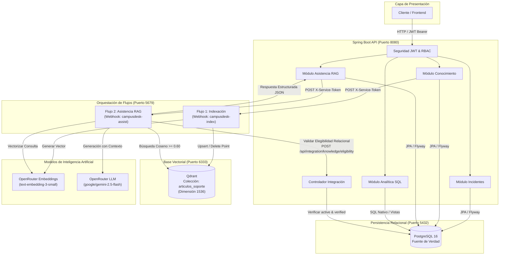

# Synapse Support Analytics

Sistema inteligente de gestión, análisis de incidentes tecnológicos y asistencia técnica fundamentada mediante **Retrieval-Augmented Generation (RAG)**.

El backend está construido con **Spring Boot 3.x (Java 21)**, base de datos relacional **PostgreSQL 16**, base de datos vectorial **Qdrant**, orquestación de flujos de automatización con **n8n**, y modelos de lenguaje/embeddings vía **OpenRouter**.

---

## 1. Arquitectura del Sistema

El sistema implementa una arquitectura desacoplada y segura donde **Spring Boot** actúa como la única fuente de verdad y punto de entrada para todas las operaciones de negocio y consultas inteligentes.



### Principios y Límites Arquitectónicos
1. **Entrada Única:** Todas las solicitudes pasan primero por Spring Boot. El cliente/frontend **nunca** se comunica directamente con n8n, Qdrant ni OpenRouter.
2. **PostgreSQL es la Fuente de Verdad:** Qdrant es un índice derivado. Un artículo solo se considera elegible para el RAG si en PostgreSQL se encuentra en estado `active = true` y `verified = true`.
3. **Validación en Dos Vías (Two-Way Verification):** Durante la asistencia RAG, n8n recupera los artículos candidatos de Qdrant y consulta a Spring Boot (`POST /api/integration/knowledge/eligibility`) antes de llamar al LLM. Si las fuentes fueron revocadas o desactivadas, el sistema responde `NO_RESULTS` en lugar de generar una respuesta alucinada.
4. **Seguridad de Integración:** La comunicación entre Spring Boot y n8n está protegida mediante cabeceras dedicadas:
   - `X-Service-Token`: Spring Boot $\rightarrow$ n8n.
   - `X-Integration-Token`: n8n $\rightarrow$ Spring Boot.

---

## 2. Flujos de Automatización n8n

Los flujos han sido diseñados utilizando nodos estándar de n8n para máxima portabilidad (sin dependencias de nodos propietarios inestables).

### Flujo 1: Indexación de Base de Conocimiento (`n8n/Flujo-1-Indexacion-Conocimiento.json`)
- **Trigger:** Webhook `POST /webhook/campusdesk-index`
- **Autenticación:** Valida la cabecera `X-Service-Token`.
- **Comportamiento:**
  - Si `operation == "UPSERT"`: Genera el embedding de 1536 dimensiones del texto (título + contenido) mediante OpenRouter (`text-embedding-3-small`), y realiza un `PUT` en Qdrant a `/collections/articulos_soporte/points` guardando metadatos (`articleId`, `title`, `category`, `version`, `estado`, `contentHash`).
  - Si `operation == "DELETE"`: Elimina el punto en Qdrant mediante `POST /collections/articulos_soporte/points/delete`.
- **Respuesta:** JSON `{ "status": "INDEXED" | "DELETED", "articleId": <id>, "vectorId": <id> }`.

### Flujo 2: Asistencia Inteligente RAG (`n8n/Flujo-2-Asistencia-RAG.json`)
- **Trigger:** Webhook `POST /webhook/campusdesk-assist`
- **Autenticación:** Valida la cabecera `X-Service-Token`.
- **Comportamiento:**
  1. Extrae la consulta (`queryText`), categoría y título del incidente.
  2. Genera el embedding de la consulta mediante OpenRouter (`text-embedding-3-small`).
  3. Ejecuta búsqueda semántica en Qdrant con filtro `{ "key": "estado", "match": { "value": "activo" } }`, similitud coseno $\ge 0.60$ y tope de 3 documentos.
  4. Si no hay coincidencias vectoriales $\rightarrow$ responde inmediatamente `status: "NO_RESULTS"`.
  5. Si hay coincidencias $\rightarrow$ invoca a Spring Boot `POST /api/integration/knowledge/eligibility` pasando los IDs y versiones de las fuentes para confirmar que siguen activas en PostgreSQL.
  6. Si ninguna fuente es elegible $\rightarrow$ responde `status: "NO_RESULTS"`.
  7. Si hay fuentes elegibles $\rightarrow$ ensambla el prompt de sistema con el contexto verificado y solicita al LLM (`google/gemini-2.5-flash` vía OpenRouter) una respuesta estructurada en formato JSON estricto (`summary`, `steps`, `recommendations`, `sourcesUsed`).
- **Respuesta:** JSON estructurado consumible directamente por el servicio de asistencia del backend.

---

## 3. Auditoría de Infraestructura y Rendimiento de Inicio

Durante la auditoría técnica del sistema se identificaron y resolvieron **5 cuellos de botella críticos** que provocaban que los contenedores tardaran varios minutos en activarse o quedaran bloqueados:

| Componente | Causa Raíz Detectada | Impacto Anterior | Solución y Optimización Implementada |
|---|---|---|---|
| **Qdrant Init** (`setup_qdrant.sh`) | El script esperaba el texto `"all systems operational"` en `/readyz`, pero Qdrant responde `all shards are ready` (HTTP 200). | Bucle infinito de reintentos cada 2s; la colección y los índices nunca se creaban. | Verificación directa con código HTTP 200 (`curl -sf .../readyz`). Inicialización completada en **< 1 segundo**. |
| **Backend Dockerfile** | Las dependencias de Gradle se descargaban en la misma capa del código fuente tras `COPY src`. | Cada cambio de código invalidaba la capa y volvía a descargar Gradle y 400 MB de librerías (4-6 min). | Separación de capas: se copian archivos Gradle primero y se pre-resuelven dependencias. Rebuild en **segundos**. |
| **Spring Boot Config** | `application.properties` requería `DB_URL` obligatoria y puerto 8051, mientras Docker enviaba variables desglosadas (`DB_HOST`, `DB_PORT`) al 8080. | Fallos de arranque al iniciar y reinicios en bucle del contenedor `backend`. | Fallback automático en `application.properties` (`${DB_URL:jdbc:postgresql://${DB_HOST:...}}`) y puerto por defecto 8080. |
| **Healthchecks** | Los intervalos eran de 5s con 5 reintentos y sin `start_period`. | Docker esperaba hasta 25-30s para declarar sanos servicios que arrancaban en 2s. | `start_period: 3s` e intervalos reducidos a 2s. Notificación de salud casi instantánea. |
| **n8n Startup** | n8n ejecutaba llamadas externas a `api.n8n.io` y `telemetry.n8n.io` para verificar versiones y telemetría. | Retardo de 20-40s esperando respuestas de red externas antes de abrir el puerto. | Variables añadidas: `N8N_DIAGNOSTICS_ENABLED=false`, `N8N_VERSION_NOTIFICATIONS_ENABLED=false`, `N8N_TEMPLATES_ENABLED=false`. Arranque en **3-5 segundos**. |

---

## 4. Guía de Despliegue con Docker Compose

El proyecto orquesta 5 servicios interconectados en la red `incidentes_net`:

| Servicio | Imagen / Build | Puerto Host | Descripción |
|---|---|---|---|
| `db` | `postgres:16-alpine` | `5432` | Base de datos relacional PostgreSQL con migraciones Flyway automáticas. |
| `qdrant` | `qdrant/qdrant:latest` | `6333` | Base de datos vectorial para recuperación semántica. |
| `qdrant-init` | `curlimages/curl:latest` | — | Inicializa automáticamente la colección `articulos_soporte` (1536 dim, Coseno) e índices de payload. |
| `n8n` | `n8nio/n8n:latest` | `5679` | Motor de flujos de automatización e integración con OpenRouter. |
| `backend` | `./backend/Dockerfile` | `8080` | API REST Spring Boot (Java 21 Temurin). |

### Paso 1: Configurar Variables de Entorno
Copia el archivo de plantilla `.env.example` a `.env` en la raíz del proyecto:

```bash
cp .env.example .env
```

Edita el archivo `.env` y coloca tu clave de OpenRouter:
```properties
# Reemplaza con tu API Key real de OpenRouter
OPENROUTER_API_KEY=sk-or-v1-tu-clave-aqui
```

> [!NOTE]
> Las contraseñas de PostgreSQL, los tokens de integración (`N8N_SERVICE_TOKEN`, `INTEGRATION_API_TOKEN`) y el secreto JWT ya vienen preconfigurados con valores seguros para el entorno de desarrollo local.

### Paso 2: Iniciar los Servicios

Ofrecemos dos métodos de despliegue según tus necesidades:

#### Opción A: Despliegue Estándar (Compilación Completa en Docker)
Ideal para entornos limpios o integración continua:

```bash
docker compose up -d
```

#### Opción B: Despliegue Ultrarrápido (< 3 segundos - Recomendado para Desarrollo Local)
Aprovecha que ya tienes Java 21 instalado en tu máquina para compilar el JAR localmente una sola vez y levantar los contenedores de forma instantánea mediante `docker-compose.fast.yml`:

```bash
# 1. Compilar el JAR localmente (toma ~10-15 segundos con la caché de Gradle)
cd backend && ./gradlew bootJar -x test && cd ..

# 2. Levantar todos los contenedores al instante
docker compose -f docker-compose.yml -f docker-compose.fast.yml up -d
```

### Paso 3: Verificar el Estado de los Servicios
Comprueba que todos los contenedores estén levantados y saludables:

```bash
docker compose ps
```

Deberías ver el siguiente estado en pocos segundos:
- `synapse-db`: Up (healthy) (~2s)
- `synapse-qdrant`: Up (healthy) (~2s)
- `synapse-qdrant-init`: Exited (0) (completado exitosamente en < 1s)
- `synapse-n8n`: Up (healthy) (~5s)
- `synapse-backend`: Up (healthy) (~15s)

---

## 5. Configuración e Importación de Flujos en n8n

Una vez que el contenedor de n8n esté arriba:

1. Abre tu navegador e ingresa a: **`http://localhost:5679`**
2. Si es la primera vez, completa el formulario de registro de usuario inicial de n8n.
3. **Configurar Credencial de OpenRouter:**
   - Ve a **Credentials** $\rightarrow$ **Add Credential**.
   - Selecciona **Header Auth**.
   - Asigna el nombre: `OpenRouter Header Auth`.
   - Name: `Authorization`
   - Value: `Bearer TU_OPENROUTER_API_KEY` (o `Bearer sk-or-v1-...`).
   - Guarda la credencial.
4. **Importar Flujo 1 (Indexación):**
   - Ve a **Workflows** $\rightarrow$ Menú de opciones (tres puntos) $\rightarrow$ **Import from File**.
   - Selecciona el archivo: [`n8n/Flujo-1-Indexacion-Conocimiento.json`](file:///C:/Users/USER26/Desktop/Proyecto-de-IA-dos/n8n/Flujo-1-Indexacion-Conocimiento.json).
   - En el nodo `OpenRouter Embeddings`, asegúrate de vincular tu credencial `OpenRouter Header Auth`.
   - Activa el flujo con el interruptor **Active** (arriba a la derecha) y guarda.
5. **Importar Flujo 2 (Asistencia RAG):**
   - Menú de opciones $\rightarrow$ **Import from File**.
   - Selecciona el archivo: [`n8n/Flujo-2-Asistencia-RAG.json`](file:///C:/Users/USER26/Desktop/Proyecto-de-IA-dos/n8n/Flujo-2-Asistencia-RAG.json).
   - En los nodos `OpenRouter Embeddings` y `OpenRouter Gemini Chat`, vincula tu credencial `OpenRouter Header Auth`.
   - Activa el flujo con el interruptor **Active** y guarda.

---

## 6. Carga de Datos Iniciales (Seed Data)

El proyecto incluye un script SQL de datos iniciales en [`database/seed_data.sql`](file:///C:/Users/USER26/Desktop/Proyecto-de-IA-dos/database/seed_data.sql) que contiene:
- **10 Usuarios del Sistema:**
  - `admin` (Administrador general)
  - `jhon_tech`, `yeison_tech`, `carlos_tech`, `maria_tech`, `david_tech` (Técnicos)
  - `ana_user`, `pedro_user`, `laura_user`, `sergio_user` (Usuarios solicitantes)
  - *Todas las contraseñas iniciales son:* `Password123!`
- **25 Artículos de Base de Conocimiento:**
  - Cubren Hardware, Software, Conectividad, Cuentas, Servidores, etc.
  - Tienen hashes SHA-256 reales, versiones editoriales y estado `verified=true`, `active=true`.
- **150 Incidentes Históricos:**
  - Con ciclo de vida completo (`NEW`, `ASSIGNED`, `IN_PROGRESS`, `RESOLVED`, `CLOSED`), fechas históricas coherentes, resoluciones técnicas y categorías normalizadas.

### Aplicar el Script en PostgreSQL
Ejecuta el siguiente comando para cargar los datos en el contenedor de base de datos:

```bash
# 1. Cargar los datos (13 usuarios, 31 artículos, 180 incidentes)
docker compose exec -T db psql -U campusdesk -d campusdesk -v ON_ERROR_STOP=1 \
  < backend/src/main/resources/db/seed/demo_data.sql

# 2. Iniciar sesión como administrador de demostración y enviar los artículos elegibles a n8n
TOKEN=$(curl -s -X POST http://localhost:8051/api/auth/login -H 'Content-Type: application/json' \
  -d '{"username":"admin.demo","password":"Demo.2026"}' | sed 's/.*"token":"\([^"]*\)".*/\1/')
curl -X POST http://localhost:8051/api/knowledge/articles/index/reconcile -H "Authorization: Bearer $TOKEN"
```

---

## 7. Solución de Posibles Fallos (Troubleshooting)

### 1. Error: `failed to connect to the docker API at npipe://...`
- **Causa:** El motor de Docker Desktop está cerrado o el servicio de Windows no ha iniciado.
- **Solución:**
  1. Abre **Docker Desktop** desde el menú inicio o escritorio.
  2. Espera a que el icono en la barra de tareas indique `Engine running`.
  3. Ejecuta nuevamente `docker compose up -d`.

### 2. Error: `bind: address already in use` (Conflicto de Puertos)
- **Causa:** Otro proceso local está usando alguno de los puertos (`8080`, `5432`, `6333`, o `5679`).
- **Solución:** Puedes cambiar los puertos expuestos en tu archivo `.env` sin modificar `docker-compose.yml`:
  ```properties
  BACKEND_PORT=8085
  DB_PORT=5433
  QDRANT_PORT=6335
  N8N_PORT=5680
  ```
  Luego reinicia con `docker compose up -d`.

### 3. Error 401 / Unauthorized en los Flujos de n8n con OpenRouter
- **Causa:** La API Key de OpenRouter no está configurada, caducó o no tiene saldo.
- **Solución:**
  1. Verifica que tu clave comience por `sk-or-v1-...` y tenga saldo activo en [OpenRouter Keys](https://openrouter.ai/keys).
  2. En n8n (`http://localhost:5679`), ve a **Credentials** $\rightarrow$ `OpenRouter Header Auth` y asegúrate de que el valor sea `Bearer sk-or-v1-tu-clave`.
  3. Asegúrate de que el archivo `.env` tenga `OPENROUTER_API_KEY=sk-or-v1-...`.

### 4. Error: `Connection refused` del Backend hacia PostgreSQL
- **Causa:** El contenedor de Spring Boot intentó conectarse antes de que la base de datos terminara de inicializar el catálogo de tablas.
- **Solución:**
  Gracias a la cláusula `depends_on: db: condition: service_healthy` en `docker-compose.yml`, Docker retiene el arranque de Spring Boot hasta que PostgreSQL responde positivamente a `pg_isready`. Si necesitas reiniciar la base:
  ```bash
  docker compose restart db
  ```

### 5. Error 404 en Qdrant: `Collection 'articulos_soporte' not found`
- **Causa:** El contenedor efímero `qdrant-init` no completó su tarea o se inició antes que Qdrant.
- **Solución:** Ejecuta manualmente la inicialización de Qdrant:
  ```bash
  docker compose run --rm qdrant-init
  ```
  Esto creará la colección con 1536 dimensiones y distancia Coseno junto a todos sus índices de payload (`category`, `categoria`, `estado`, `articleId`).

### 6. Reinicio Limpio Total (Reset de Datos y Volúmenes)
- Si deseas borrar toda la base relacional, la base vectorial y reiniciar todo desde cero:
  ```bash
  # 1. Detener y remover contenedores junto a volúmenes
  docker compose down -v

  # 2. Volver a levantar todo limpio
  docker compose up -d

  # 3. Re-aplicar el seed de datos
  docker compose exec -T db psql -U postgres -d incidentes_db -f /seed_data.sql
  ```

---

## 8. Referencia de Endpoints de la API REST

Swagger UI disponible en: **`http://localhost:8080/swagger-ui/index.html`**

### Autenticación y Cuentas
- `POST /api/auth/login`: Autenticación de usuario. Devuelve token JWT (duración 30 min).
- `POST /api/auth/change-password`: Cambio de contraseña obligatorio o voluntario.
- `GET /api/user/profile`: Datos del usuario autenticado actual.
- `GET /api/user/users`: Lista de usuarios (exclusivo `ADMIN`).

### Incidentes (Tickets)
- `POST /api/tickets`: Creación de incidentes (exclusivo rol `USER`). Requiere `title`, `description`, `category` o `categoryId`, y `priority` (`BAJA`, `MEDIA`, `ALTA`, `CRITICA`).
- `GET /api/tickets?page=0&size=20`: Listado paginado con control de acceso por recurso (usuarios ven sus tickets, técnicos ven sus asignados, administradores ven todos).
- `GET /api/tickets/{id}`: Detalle del ticket y su historial de estados.
- `POST /api/tickets/{id}/assign`: Asignación de técnico (exclusivo `ADMIN`).
- `PATCH /api/tickets/{id}/status`: Transición de estado (`ASSIGNED`, `IN_PROGRESS`, `RESOLVED`, `CLOSED`). `RESOLVED` exige obligatoriamente `resolutionNote`.

### Base de Conocimiento
- `POST /api/knowledge/articles`: Creación de borrador de artículo.
- `PUT /api/knowledge/articles/{id}`: Edición de artículo (incrementa versión y revoca verificación).
- `PATCH /api/knowledge/articles/{id}/verify`: Verificación técnica del artículo (exclusivo `ADMIN`).
- `PATCH /api/knowledge/articles/{id}/activate`: Activación y disparo automático de indexación hacia n8n.
- `PATCH /api/knowledge/articles/{id}/deactivate`: Desactivación y disparo de eliminación vectorial en Qdrant.
- `GET /api/knowledge/articles`: Listado de artículos con filtros por estado editorial e índice.

### Asistencia RAG y Calificaciones
- `POST /api/tickets/{ticketId}/assistance`: Solicitar orientación técnica asistida por IA para un ticket específico.
  - **Autorización:** Solo el solicitante del ticket, el técnico asignado o un administrador pueden consultarlo.
  - **Regla:** El ticket no debe estar en estado `CLOSED`.
  - **Respuesta:** Devuelve la consulta persistida con la respuesta generada, fuentes fundamentadas y tiempo de respuesta.
- `GET /api/assistance/queries/{queryId}`: Consultar el estado y detalle de una consulta previa.
- `POST /api/assistance/responses/{responseId}/rate`: Calificar la utilidad de la respuesta de IA (escala de 1 a 5 estrellas, con comentario opcional). Exclusivo para el usuario que solicitó la consulta.
- `GET /api/assistance/responses/{responseId}/rating`: Obtener la calificación actual de una respuesta.

### Analítica de Incidentes
- `GET /api/analytics/summary`: Indicadores consolidados calculados directamente con SQL verificable:
  - Tiempo promedio de resolución (horas).
  - Tasa de resolución (%).
  - Tasa de escalamiento (%).
  - Total de incidentes, resueltos y pendientes.
  - Distribución por categoría y severidad.
  - Tendencia semanal.
  - Filtros opcionales por rango de fechas (`startDate`, `endDate`), categoría y severidad.

---

## 9. Ejecución de Pruebas Unitarias e Integrales

El backend cuenta con una suite completa de pruebas automatizadas que validan todas las reglas de negocio, seguridad, concurrencia, integración con n8n y ciclo RAG:

```bash
cd backend
./gradlew test
```

### Resultados de la Suite de Pruebas:
- **Total de pruebas:** 82
- **Fallos:** 0
- **Errores:** 0
- **Tasa de éxito:** 100%

### Cobertura de las Pruebas:
- `JwtPropertiesBindingTests`, `PasswordPolicyTests`, `PasswordChangeFlowTests`, `PasswordChangeRequiredTests`: Seguridad, tokens e invalidación por versión de credenciales.
- `TicketAssignmentTests`: Asignación única por servicio, control de concurrencia y roles válidos.
- `TicketResolutionTests`, `TicketPaginationTests`: Reglas de transición de estados, notas obligatorias y paginación `PageResponse`.
- `CategoryTests`, `UserAccountPolicyTests`: Catálogo de categorías, restricciones de roles y baja lógica de usuarios.
- `KnowledgeArticleTests`, `KnowledgeIndexTests`: Ciclo de vida editorial de artículos, sincronización fuera de transacción con n8n, manejo de fallos y aislamiento de sesiones Hibernate.
- `AssistanceTests`: Ciclo completo de consultas RAG (`PENDING` $\rightarrow$ `ANSWERED` / `NO_RESULTS`), validación relacional de fuentes y calificaciones 1-5 estrellas por el solicitante.
- `AnalyticsTests`: Verificación de cálculo de los siete indicadores analíticos con datos de cohorte en PostgreSQL / H2.

---

## 10. Consideraciones de Seguridad y Buenas Prácticas

- **Cero Secretos en el Código:** Todos los secretos (JWT, credenciales de base de datos, API Keys de OpenRouter, tokens de integración) se inyectan estrictamente por variables de entorno.
- **Tokens Invalidados Inmediatamente:** El sistema utiliza un claim de versión de credenciales (`cv`). Cuando un usuario cambia o restablece su contraseña, todos los JWT emitidos previamente quedan invalidados de inmediato sin necesidad de consultar una lista negra en memoria o Redis.
- **RAG Fundamentado y Anti-Alucinación:** El flujo de n8n opera con instrucciones estrictas de abstención: si la similitud semántica es inferior a 0.60 o las fuentes son revocadas por Spring Boot, el modelo no genera conjeturas y responde `NO_RESULTS`.
- **Prevención de Ataques en Base de Datos:** Todas las consultas analíticas y de negocio utilizan JPA estructurado o sentencias preparadas nativas con parámetros tipados para evitar inyección SQL.

---
*Desarrollado para el proyecto académico Synapse Support Analytics (CampusDesk) — Noviembre 2026.*
