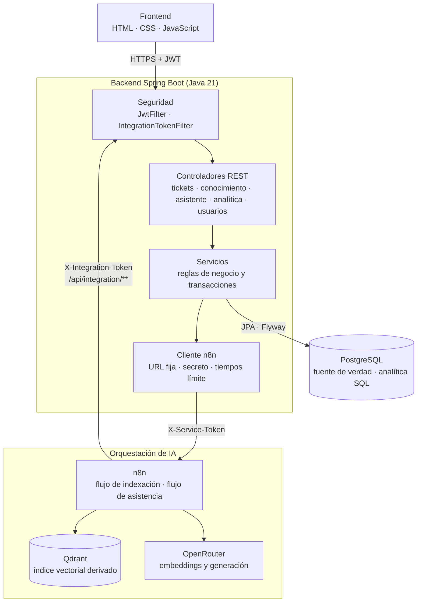
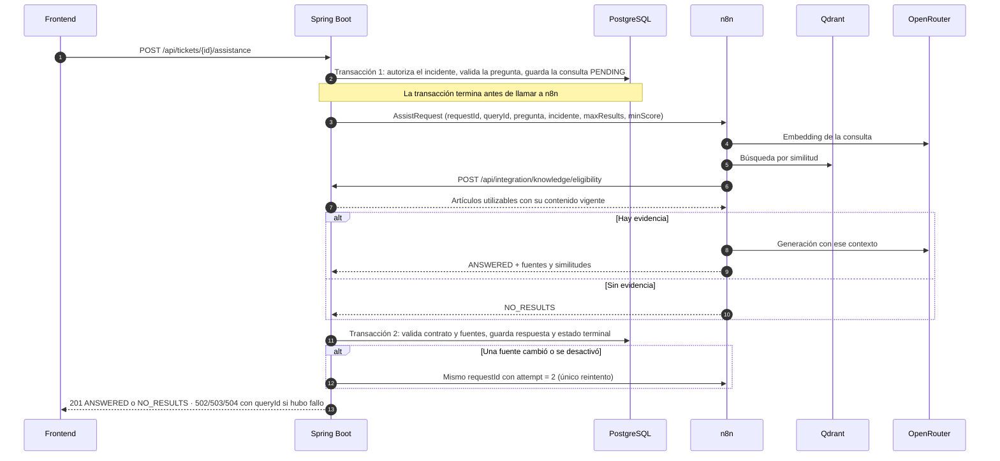
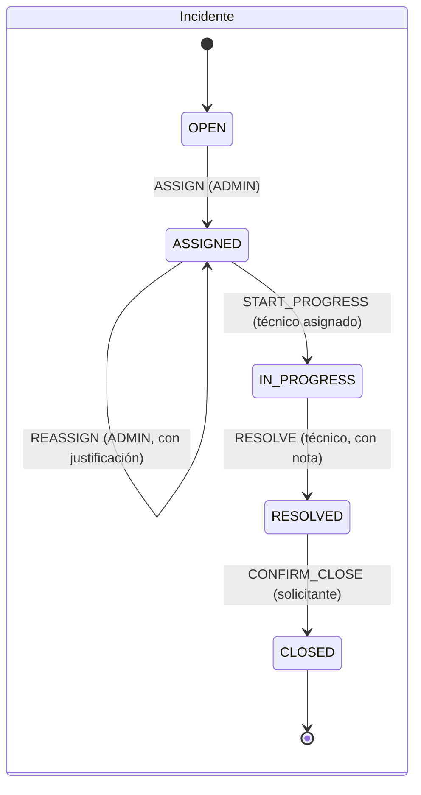
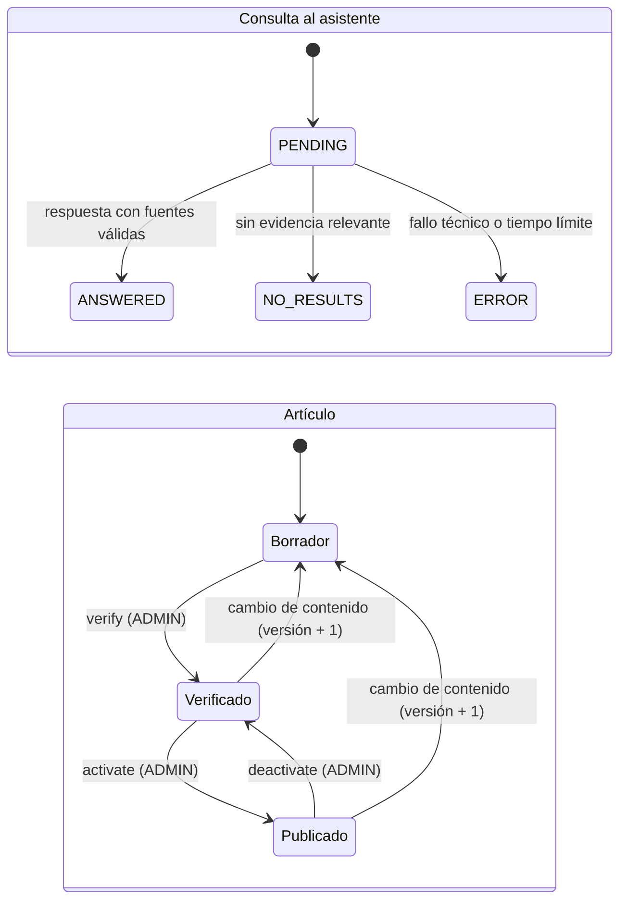
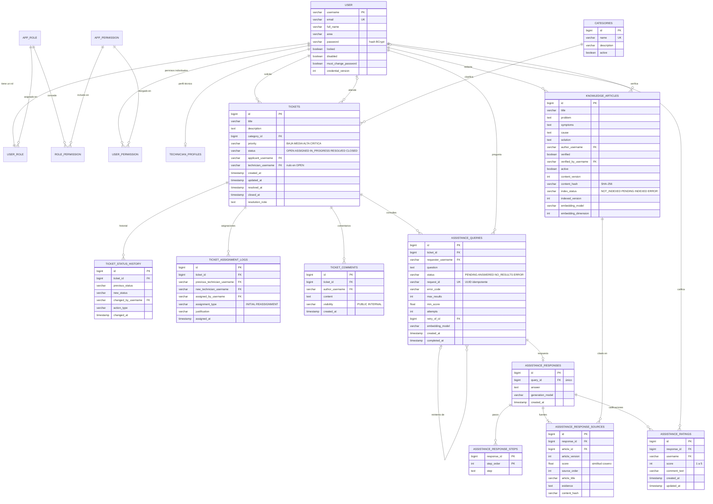

# Diagramas: arquitectura y modelo entidad-relación

Los diagramas están en Mermaid: GitHub los dibuja al abrir este archivo. Describen el backend tal
como está implementado (migraciones `V1` a `V8`). El frontend, Docker Compose, Qdrant y los
workflows de n8n pertenecen a otros integrantes y aparecen aquí solo como componentes externos.

## 1. Arquitectura



Límites que el diseño mantiene:

- El frontend solo habla con Spring Boot. Nunca con n8n, Qdrant ni OpenRouter.
- PostgreSQL decide si un artículo existe y puede usarse. Qdrant es un índice derivado: un vector que sobra no convierte un artículo inactivo en fuente.
- Spring Boot no tiene credenciales de Qdrant ni de OpenRouter; viven en n8n.
- La analítica se calcula con SQL sobre PostgreSQL. Ningún modelo interviene en esas cifras.

## 2. Flujo de una consulta al asistente



## 3. Flujo de indexación de un artículo

```mermaid
sequenceDiagram
    autonumber
    participant A as ADMIN
    participant S as Spring Boot
    participant P as PostgreSQL
    participant N as n8n
    participant Q as Qdrant

    A->>S: POST /api/knowledge/articles/{id}/activate
    S->>P: active = true, indexStatus = PENDING
    S->>N: IndexRequest UPSERT (artículo, versión, contenido, hash)
    N->>Q: Reemplaza los puntos del artículo (identidad por artículo y fragmento)
    N-->>S: INDEXED (modelo, dimensión)
    S->>P: indexStatus = INDEXED solo si el artículo no cambió entre tanto
    Note over S,P: Si n8n falla: indexStatus = ERROR; el artículo sigue publicado y se reintenta
```

Desactivar o cambiar el contenido envía `DELETE` para retirar los vectores. La exclusión del
artículo no depende de esa limpieza: la validación relacional lo descarta desde el primer momento.

## 4. Estados





## 5. Modelo entidad-relación

Equivalencia con el enunciado: Usuario = `user`, Categoria = `categories`, Incidente = `tickets`,
ArticuloConocimiento = `knowledge_articles`, ConsultaIA = `assistance_queries`, RespuestaIA =
`assistance_responses`, FuenteRespuesta = `assistance_response_sources`, Calificacion = `assistance_ratings`.



Restricciones de integridad destacadas (definidas en las migraciones, no solo en el código):

| Regla | Dónde |
|---|---|
| Un artículo solo puede estar activo si está verificado | `ck_article_active_requires_verified` (`V6`) |
| Una respuesta por consulta | `uk_assist_response_query` (`V7`) |
| Una sola consulta en proceso por usuario e incidente | Índice único parcial `uk_assist_query_one_pending` (`V7`) |
| Una consulta pendiente no tiene fecha de cierre; una terminal sí | `ck_assist_query_completed` (`V7`) |
| Código de error solo en `ERROR` | `ck_assist_query_error` (`V7`) |
| Similitud entre −1 y 1 | `ck_assist_source_score` (`V7`) |
| Puntuación entre 1 y 5; una calificación por usuario y respuesta | `ck_assist_rating_score`, `uk_assist_rating_response_user` (`V8`) |
| Prioridad canónica | `tickets_priority_check` (`V3`) |
| Sin `ON DELETE CASCADE` | Usuarios, incidentes y artículos no se eliminan: se deshabilitan o desactivan |

Tablas que existen y no se muestran por brevedad: `ticket_lifecycle_rules` (reglas de la máquina de
estados), `user_role_history` y `dashboard_metrics_cache` (heredada; la analítica no la usa).
